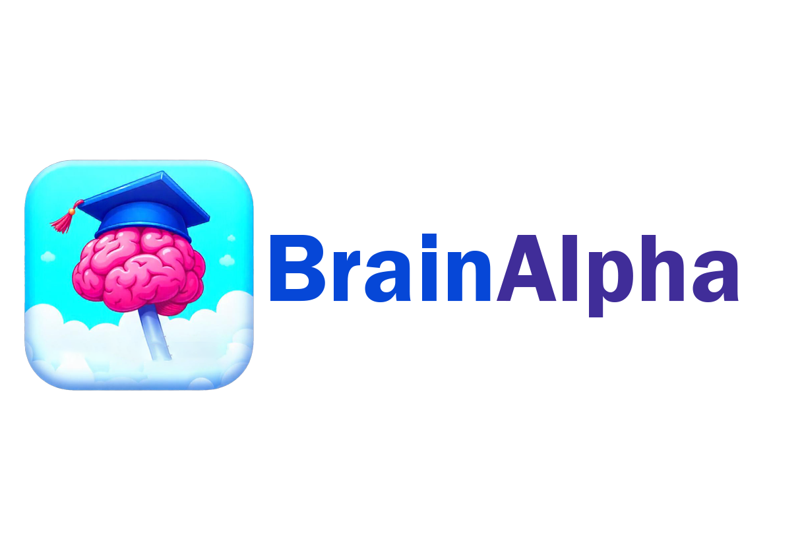

# 🧠 BrainAlpha - Mental Training




## Development

scoop install nodejs

```pwsh
cd site
npm start
```

para ci   commit con @pages

## 🟦 Project Overview

**BrainAlpha** is an open-source application designed to enhance memory, concentration, logic, and mental agility through interactive games. The app is completely free, with no ads or in-app purchases, and is inclusive for people with cognitive difficulties.  

BrainAlpha offers its users features such as:
 - Challenges divided into categories and levels.
 - Measure your progress with statistics.
 - Customize the app to your liking (favorite categories, interface, levels, etc.).

All project documentation is available in the ▶ [`docs/`](docs/) folder.

---

## 🟦 Project Status

 **Current Version:** v0.1   
 **Latest Update:** March 2025  
 **Development Stage:** MVP - First iteration completed  
 **Demo:** The initial APK has been built and is available for testing.  

For a list of upcoming features and improvements, check ▶ [Development Roadmap](docs/roadmap.md).

---

## 🟦 Download the APK

You can download the latest version of BrainAlpha here:  
▶ **[BrainAlpha v0.1 APK](https://g8-c23437.gitlab.io)**  

---

## 🟦 Project Objectives

- Develop a **cross-platform** application with cognitive training game.
- Enable users to **track their progress** with detailed statistics.
- Provide **personalized training** based on user performance.
- Maintain an **open-source** model under the **GPL license**.

For more details, check ▶ [Project Objectives](docs/objectives.md).

---

## 🟦 Business Goals / Use Cases

- Provide **effective and accessible mental training** for all users.
- Encourage **motivation and consistency** through achievements.
- Offer **progress tracking and insights** to users.
- Ensure **cloud synchronization** across multiple devices.
- Maintain a **completely free** development model with no ads or payments.

Full use cases can be found in ▶ [Use Cases](docs/use_cases.md).

---

## 🟦 Data Sources

BrainAlpha stores and manages data using **Supabase**, an open-source database compatible with PostgreSQL.
 - User data (authentication and progress).
 - Game data (statistics, levels, difficulty).

For details on data structure, check ▶ [Data Model](docs/data_model.md).

## 🟦 Applied Technologies

The app is built using a modern architecture with well-structured technologies:

| Area         | Technologies Used |
|-------------|------------------|
| **Frontend** | Kotlin + Jetpack Compose |
| **Backend**  | Supabase (Firebase optional) |
| **Database** | Supabase (PostgreSQL) |
| **Infrastructure** | GitLab CI/CD for continuous integration |
| **Authentication** | Supabase Auth (Firebase optional) |
| **Notifications** | WorkManager |

For a detailed architecture overview, see ▶ [Project Architecture](docs/architecture.md).

---

## 🟦 Development Roadmap

BrainAlpha is continuously evolving. Here’s what’s planned for future updates:

-  **Sprint 1:** Database setup, authentication system, first game prototype.
-  **Sprint 2:** Improved UI/UX, more cognitive training games, statistics system.
-  **Sprint 3:** Achievements, leaderboard, and advanced customization.

For a full roadmap, check ▶ [Development Roadmap](docs/roadmap.md).

---

## 🟦 Initial Mockups

We have designed the first **mockups* showcasing three of BrainAlpha's key features:

1. **Home screen and navigation**
2. **Cognitive training games**
3. **Progress tracking and statistics panel**

View the designs here ▶ [Mockups & UI](docs/mockups.md).

---

## 🟦 Non-Functional Requirements

To ensure high-quality standards, BrainAlpha meets the following non-functional requirements:

- **Availability:** 99.9% uptime through cloud infrastructure.
- **Performance:** Optimized for mid and low-range devices.
- **Security:** Data protection with encryption and secure authentication.
- **Accessibility:** Interface adapted for people with cognitive challenges.

Full list of non-functional requirements in ▶ [Non-Functional Requirements](docs/non_functional_requirements.md).

---

## 🟦 Open Source License

BrainAlpha is an **open-source project** under the **GPL license**, allowing:

- Free usage of the application.
- Code modification to fit different needs.
- Contributions to improve and expand the project.

More details ▶ [License](docs/license.md).

---

## 🟦 How to Contribute

If you want to contribute, follow these steps:

 1. **Clone the repository:**
 ```bash
 git clone https://gitlab.com/provencat/dam/brain-alpha.git
 ```

 2. **Create a new branch:**
 ```bash
 git checkout -b feature/new_feature
 ```

 3. **Make changes and push your code**:
 ```bash
 git add .
 git commit - "Added new feature"
 git push origin feature/new_feature
 ```

 4. **Open a Merge Request on GitLab.**


------------------------------

This is a Kotlin Multiplatform project targeting Android, Web, Desktop.

* `/composeApp` is for code that will be shared across your Compose Multiplatform applications.
  It contains several subfolders:
  - `commonMain` is for code that’s common for all targets.
  - Other folders are for Kotlin code that will be compiled for only the platform indicated in the folder name.
    For example, if you want to use Apple’s CoreCrypto for the iOS part of your Kotlin app,
    `iosMain` would be the right folder for such calls.


Learn more about [Kotlin Multiplatform](https://www.jetbrains.com/help/kotlin-multiplatform-dev/get-started.html),
[Compose Multiplatform](https://github.com/JetBrains/compose-multiplatform/#compose-multiplatform),
[Kotlin/Wasm](https://kotl.in/wasm/)…

We would appreciate your feedback on Compose/Web and Kotlin/Wasm in the public Slack channel [#compose-web](https://slack-chats.kotlinlang.org/c/compose-web).
If you face any issues, please report them on [GitHub](https://github.com/JetBrains/compose-multiplatform/issues).

You can open the web application by running the `:composeApp:wasmJsBrowserDevelopmentRun` Gradle task.