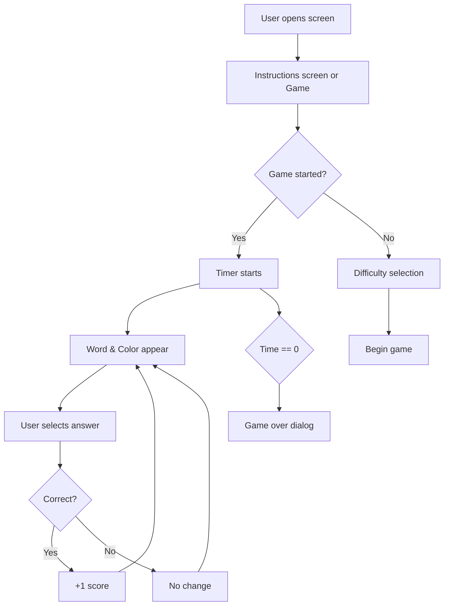

# Stroop Test Game — Technical Documentation

## Overview

The Stroop Test Game is a **cognitive attention-based minigame** that challenges players to select the **color of the text** displayed on screen, rather than the textual content itself. It mimics the psychological Stroop Effect, which measures the **interference in the reaction time** of a task.

This module is implemented using **Jetpack Compose Multiplatform**, with the core logic separated into Model, Controller, and View layers.

---

## Architecture Summary

### 1. `stroopModel.kt`
Contains all core game state and logic.

- `score`: Mutable score counter.
- `timeLeft`: Countdown timer.
- `isGameOver`: Game-end flag.
- `currentWord`: Data class containing the current word and its display color.
- `options`: List of shuffled color options.
- `lastAnswerCorrect`: Tracks correctness of the last submitted answer.
- `currentDifficulty`: Enum — `EASY`, `MEDIUM`, `HARD`.
- `hasStartedGame`: Indicates if the game session has been initiated.

#### Key Functions

| Function | Purpose |
|---------|---------|
| `resetGame()` | Resets state for a new game session. |
| `submitAnswer(color)` | Processes user input and updates the round. |
| `decreaseTimer()` | Decrements timer by 1 second. Ends game if 0. |
| `generateRandomWord()` | Creates a random mismatch/match of word and color. |
| `getColorName(color)` | Maps a `Color` object back to its name. |
| `getTimeForDifficulty()` | Returns total game time based on difficulty. |

---

### 2. `stroopController.kt`
Bridges the model and view logic. Manages:

- UI state (`State<T>` bindings).
- Coroutine-based countdown loop.
- Navigation and feedback timing.
- Instructions toggle.

#### Notable Responsibilities

- `startGame()` initializes and begins a session.
- `checkAnswer()` processes color selection with feedback lockout.
- `clearFeedback()` clears answer result after brief delay.
- `stopGame()` cancels active timers on view disposal.

> All composables should **observe derived states** from the controller to ensure correct reactivity and separation of concerns.

---

### 3. `StroopScreen.kt`
The main game view.

- Renders:
    - Timer & progress bar
    - Current word in color
    - Answer buttons
    - Score counter
- Displays `AlertDialog` on game over.
- Provides difficulty selection UI.
- Disposes timer on screen unload.

### 4. `StroopInstructionsScreen.kt`
- Displays instructions using a stylized card.
- Leverages `AnnotatedString` for rich text rendering.
- Has a back button for dismissing the modal.

---

## Game Flow

## Difficulty Mechanics

| Difficulty | Duration | Unlock Condition |
|------------|----------|------------------|
| EASY       | 45 sec   | Default          |
| MEDIUM     | 30 sec   | 50 neurons       |
| HARD       | 15 sec   | 150 neurons      |

- ✅ Each correct answer: **+100 points = +1 neuron**
- ❌ Each incorrect answer: **–20 points**

Neurons are accumulated in the user's profile and used to unlock higher difficulty levels.

---

## UI & UX

- 🎨 Randomized colors every round
- 🧠 Shadow on the central color word
- 🚀 Smooth transitions using `AnimatedContent`
- 🕹️ Double-click protection during feedback
- 📱 Responsive layout for all screen sizes

---

## Testability

The game model logic is fully decoupled and highly testable:

- `resetGame()` is useful for test setups.
- `submitAnswer(color)` validates response logic.
- `generateRandomWord()` is pure and deterministic.
- `getColorName()` / `getColorHex()` provide accurate mappings.

To test the countdown system, simulate repeated calls to `decreaseTimer()`.

---

## Integration Requirements

### Dependencies

- Kotlin Coroutines (`Job`, `launch`, `delay`)
- Jetpack Compose Multiplatform (`State`, `LaunchedEffect`, `AnimatedContent`)
- Localization system via `Strings.t(key)`
- Navigation: `LoginController.navigateTo(route)`
- User session: `UserSession.getUserId()`
- Game result registration: `GameSessionController.registerGameSession(...)`

---

## Future Enhancements

- 🔊 Feedback sound effects
- ♿ Colorblind-friendly mode

---

## Conclusion

The **Stroop Game** is a self-contained, efficient module designed with clear separation of responsibilities. It is ideal for educational or cognitive training applications, supporting easy maintenance, feature expansion, and an engaging user experience.

This module blends fun with cognitive stimulation in a scalable, robust way.