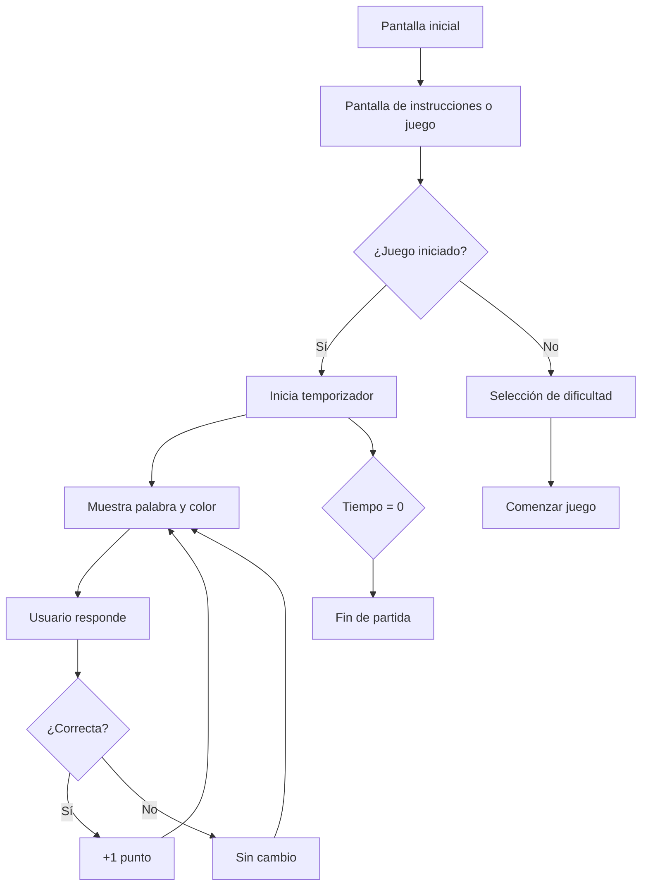

# Juego Test de Stroop — Documentación Técnica

## Visión General

El juego del Test de Stroop es un **minijuego cognitivo basado en la atención** que reta al jugador a seleccionar el **color del texto mostrado en pantalla**, en lugar del contenido textual. Simula el Efecto Stroop psicológico, que mide la **interferencia en el tiempo de reacción** durante tareas contradictorias.

Este módulo está implementado con **Jetpack Compose Multiplatform**, siguiendo un diseño modular dividido en capas de Modelo, Controlador y Vista.

---

## Resumen de Arquitectura

### 1. `stroopModel.kt`
Contiene el estado del juego y la lógica principal.

- `score`: Puntuación acumulada del jugador.
- `timeLeft`: Temporizador regresivo.
- `isGameOver`: Bandera de finalización de partida.
- `currentWord`: Clase con palabra actual y su color visual.
- `options`: Lista de colores aleatorios como opciones.
- `lastAnswerCorrect`: Resultado de la última respuesta.
- `currentDifficulty`: Enum con niveles `EASY`, `MEDIUM`, `HARD`.
- `hasStartedGame`: Indica si la sesión ha comenzado.

#### Funciones Clave

| Función                  | Propósito                                           |
|--------------------------|-----------------------------------------------------|
| `resetGame()`            | Reinicia todos los valores para comenzar una partida nueva. |
| `submitAnswer(color)`    | Procesa la entrada del usuario y avanza a la siguiente ronda. |
| `decreaseTimer()`        | Disminuye el temporizador en 1 segundo. Finaliza el juego si llega a 0. |
| `generateRandomWord()`   | Genera un nuevo par aleatorio de palabra y color. |
| `getColorName(color)`    | Devuelve el nombre del color desde un objeto `Color`. |
| `getTimeForDifficulty()` | Devuelve la duración según el nivel de dificultad. |

---

### 2. `stroopController.kt`
Hace de puente entre el modelo y la vista. Administra:

- Estados de UI mediante `State<T>`.
- Temporizador basado en corrutinas.
- Navegación y lógica de retroalimentación.
- Activación de la pantalla de instrucciones.

#### Responsabilidades Clave

- `startGame()` inicia una nueva sesión.
- `checkAnswer()` evalúa la respuesta con bloqueo temporal de inputs.
- `clearFeedback()` borra el feedback visual.
- `stopGame()` detiene los temporizadores al salir.

> Todas las composables deben **observar los estados derivados** del controlador para mantener la reactividad y separación de lógica.

---

### 3. `StroopScreen.kt`
Vista principal del juego.

- Renderiza:
    - Temporizador y barra de progreso
    - Palabra coloreada central
    - Botones de respuesta
    - Contador de puntuación
- Muestra `AlertDialog` al finalizar la partida.
- Interfaz de selección de dificultad.
- Detiene el temporizador al cerrar la pantalla.

### 4. `StroopInstructionsScreen.kt`
- Muestra las instrucciones en una tarjeta visualmente atractiva.
- Usa `AnnotatedString` para formateo enriquecido.
- Incluye botón para volver al juego.

---

## Flujo de Juego

## Mecánicas de Dificultad

| Dificultad | Duración | Desbloqueo       |
|------------|----------|------------------|
| FÁCIL      | 45 seg   | Por defecto      |
| MEDIA      | 30 seg   | 50 neuronas      |
| DIFÍCIL    | 15 seg   | 150 neuronas     |

✅ **Cada respuesta correcta:** +100 puntos = +1 neurona  
❌ **Cada error:** –20 puntos

Las neuronas se acumulan en el perfil del usuario y permiten desbloquear niveles más avanzados.

---

## UI y UX

- 🎨 Colores aleatorios por ronda
- 🧠 Sombra aplicada a la palabra central
- 🚀 Transiciones suaves mediante `AnimatedContent`
- 🕹️ Protección contra doble clic durante el feedback
- 📱 Diseño adaptable a móviles y tablets

---

## Testabilidad

La lógica del modelo está desacoplada y es altamente testeable:

- `resetGame()` útil en la configuración de pruebas.
- `submitAnswer(color)` verifica la lógica de aciertos.
- `generateRandomWord()` es pura y determinista.
- `getColorName()` / `getColorHex()` devuelven resultados consistentes.

Para probar el temporizador, se pueden simular llamadas repetidas a `decreaseTimer()`.

---

## Requisitos de Integración

### Dependencias

- **Kotlin Coroutines:** `Job`, `launch`, `delay`
- **Jetpack Compose Multiplatform:** `State`, `LaunchedEffect`, `AnimatedContent`
- **Sistema de localización:** `Strings.t(key)`
- **Navegación:** `LoginController.navigateTo(route)`
- **Sesión de usuario:** `UserSession.getUserId()`
- **Registro de partidas:** `GameSessionController.registerGameSession(...)`

---

## Mejoras Futuras

- 🔊 Sonidos de retroalimentación
- ♿ Modo accesible para personas daltónicas

---

## Conclusión

El **Test de Stroop** es un módulo autocontenible, eficiente y bien estructurado.  
Su diseño modular y clara separación de responsabilidades lo hacen ideal para apps de entrenamiento cognitivo o educativas.

Está pensado para combinar aprendizaje, entretenimiento y estimulación mental de forma efectiva, escalable y fácil de mantener.
