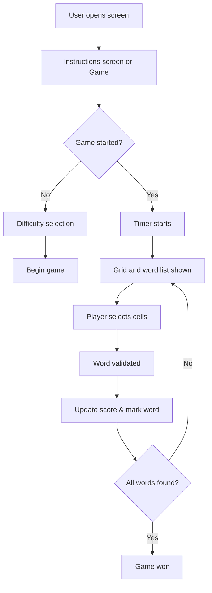

# 🧩 Word Search — Technical Documentation

## Overview

The Word Search game is a **visual pattern recognition and logic-based minigame** that challenges players to find hidden words in a grid of letters. The gameplay exercises attention, memory, and spatial reasoning.

This module is implemented using **Jetpack Compose Multiplatform**, and is structured into **Model**, **Controller**, and **View** layers for clean separation of concerns.

---

## Architecture Summary

### 1. `wordSearchModel.kt`

Holds the core game state and word placement logic.

- `grid`: 10x10 `CharArray` representing the word matrix.
- `wordsToFind`: List of words to locate.
- `foundWords`: Set of words already discovered by the player.
- `gameStarted`: Mutable state flag.
- `difficulty`: Enum for `EASY`, `MEDIUM`, `HARD`.

#### Key Functions

| Function | Purpose |
|---------|---------|
| `generateGame(words)` | Initializes the board with selected words. |
| `placeWordsInGrid()` | Randomly places words in the grid (horizontal, vertical, diagonal). |
| `fillEmptySpaces()` | Fills unused grid cells with random letters. |
| `isGameFinished()` | Checks if all target words have been found. |
| `markWordAsFound(word)` | Marks a word as completed. |
| `getGrid()` | Returns the current grid layout. |

---

### 2. `wordSearchController.kt`

Handles interaction between the model and view.

- UI state control (`showInstructions`, `selectedCells`)
- Navigation management
- Game lifecycle logic

#### Responsibilities

- `configureGame(difficulty)`: Prepares word list based on difficulty.
- `startGame()`: Triggers game generation and resets state.
- `resetSelection()`: Clears current selection.
- `isWordCorrect()`: Validates selected sequence against the word list.
- `calculateScore(timeElapsed)`: Computes final score based on time & difficulty.

---

### 3. `wordSearchScreen.kt`

Main game UI implementation using Compose.

- Renders:
  - Top bar with profile & score
  - Timer display
  - Letter grid
  - Word list
  - Validation & restart controls

- Validates selections and updates score when a word is found.

### 4. `InstructionsWordSearch.kt`

- Displays onboarding instructions with rich formatting.
- Includes a start button to begin gameplay.
- Styled using `AnnotatedString`.

---

## Game Flow

---

## Difficulty Mechanics

| Difficulty | Words to Find | Unlock Condition |
|------------|----------------|------------------|
| EASY       | 5–8 words       | Default          |
| MEDIUM     | 10–15 words     | 75 neurons       |
| HARD       | 20–25 words     | 150 neurons      |

- Neuron rewards are based on speed and difficulty.
- Faster solves yield higher score multipliers.

---

## UI & UX

- 🔡 Dynamic word grid
- ✍️ Cell highlights for selection and validation
- 💬 Real-time feedback on matches
- 🧾 Word list with strikethrough for found words
- ⏱️ MM:SS countdown timer

---

## Testability

- `generateGame()` produces deterministic output with seedable inputs.
- `markWordAsFound(word)` allows isolated unit testing.
- Grid-based validation logic is independent of the UI layer.

---

## Integration Requirements

### Dependencies

- Kotlin Coroutines (`launch`, `delay`)
- Jetpack Compose Multiplatform (`State`, `LaunchedEffect`, etc.)
- Navigation: `navigateTo("logic")`
- User state: `UserSession`, `GameSessionController`

---

## Future Enhancements

- 🔊 Sound cues for correct/incorrect words
- 📱 Adaptive layout for tablets and foldables
- 🌈 Color themes for accessibility
- 🌍 Multilingual word lists

---

## Conclusion

The **Word Search** module is a polished, scalable minigame that fits well into a cognitive training app suite.  
It offers an engaging experience while reinforcing visual scanning and word recognition skills.

The codebase is cleanly separated by responsibility, making it highly testable and extensible.
