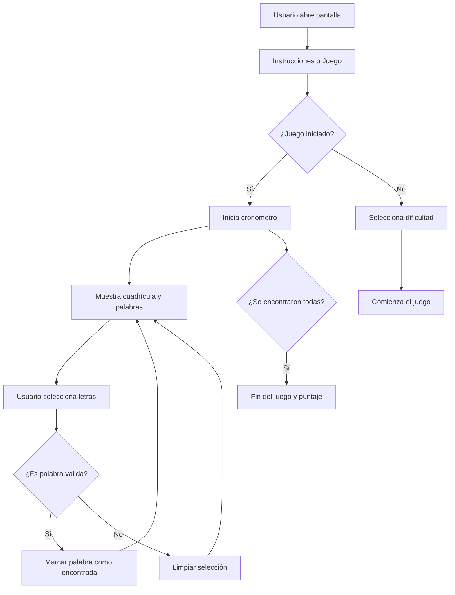

# 🧩 Sopa de Letras — Documentación Técnica

## 🧠 Visión General

El juego **Sopa de Letras** es un minijuego de lógica visual en el que el jugador debe encontrar palabras ocultas en una cuadrícula de letras. Las palabras pueden estar ubicadas de forma **horizontal**, **vertical** o **diagonal**, y deben seleccionarse en orden secuencial.

Está desarrollado con **Jetpack Compose Multiplatform**, con una arquitectura separada en **Modelo**, **Controlador** y **Vista** para asegurar claridad, mantenimiento y testabilidad.

---

## 📐 Arquitectura

### 1. `wordSearchModel.kt`

Contiene toda la lógica del juego y el estado actual.

#### Variables clave

- `grid`: Matriz de 10x10 que representa el tablero de letras.
- `wordsToFind`: Lista de palabras ocultas a encontrar.
- `foundWords`: Conjunto de palabras que ya han sido encontradas.
- `difficulty`: Dificultad actual (enum): `EASY`, `MEDIUM`, `HARD`.
- `gameStarted`: Estado observable de si el juego ha iniciado.

#### Funciones importantes

| Función | Descripción |
|--------|-------------|
| `generateGame(words)` | Inicia un nuevo tablero con palabras específicas. |
| `placeWordsInGrid()` | Coloca las palabras seleccionadas en la cuadrícula. |
| `fillEmptySpaces()` | Rellena las celdas vacías con letras aleatorias. |
| `isWordFound(word)` | Verifica si una palabra fue encontrada. |
| `isGameFinished()` | Verifica si todas las palabras fueron descubiertas. |
| `markWordAsFound(word)` | Marca una palabra como encontrada. |

---

### 2. `wordSearchController.kt`

Mediador entre la vista y el modelo.

#### Responsabilidades

- Gestión de selección de celdas.
- Validación de palabras seleccionadas.
- Gestión del estado de las instrucciones.
- Manejo de la dificultad y configuración inicial.
- Registro de partida finalizada.

#### Métodos clave

| Función | Propósito |
|--------|-----------|
| `configureGame(difficulty)` | Configura el juego según la dificultad. |
| `startGame()` | Inicia una nueva partida. |
| `getGrid()` | Retorna la cuadrícula actual. |
| `getWordsToFind()` | Lista de palabras por encontrar. |
| `isGameFinished()` | Comprueba si terminó la partida. |
| `calculateScore(seconds)` | Calcula puntaje según tiempo y dificultad. |

---

### 3. `wordSearchScreen.kt`

La vista principal del juego.

Renderiza:

- 👤 Barra superior con nombre de usuario y ajustes.
- 🔤 Cuadrícula interactiva de letras.
- 📜 Lista de palabras por encontrar.
- ⏱️ Cronómetro en formato MM:SS.
- ✅ Validación visual de palabras encontradas.
- 🧮 Mostrar puntaje final al ganar.

Maneja:

- Selección secuencial de celdas.
- Validación de palabras en tiempo real.
- Guardado del progreso en base de datos.

---

### 4. `InstructionsWordSearch.kt`

Vista con las instrucciones del juego.

- Explica la mecánica de seleccionar palabras.
- Presenta ejemplos y consejos básicos.
- Botón para iniciar la partida.

---

## 🔄 Flujo del Juego

---

## ⚙️ Dificultad

| Dificultad | Palabras  | Tiempo recomendado | Desbloqueo |
|------------|-----------|--------------------|------------|
| 🟢 Fácil   | 5–8       | ≤ 90s              | Por defecto |
| 🔵 Media   | 10–15     | ≤ 120s             | 75 neuronas |
| 🔴 Difícil | 20–25     | ≤ 150s             | 150 neuronas |

🧠 Las neuronas se ganan por partida y sirven para desbloquear niveles superiores.

---

## 💡 UX y Diseño

- ✅ Animación de celdas al seleccionarse.
- 🧠 Palabras validadas se marcan con color.
- 📱 Compatible con pantallas pequeñas.
- 🔒 Dificultades avanzadas se desbloquean con progreso.
- 📜 Soporte para selección diagonal, horizontal y vertical.

---

## 🧪 Testabilidad

La lógica del modelo es completamente desacoplada:

- `generateGame()` y `placeWordsInGrid()` pueden ser probadas por separado.
- `isWordFound()` y `isGameFinished()` permiten validación automática.
- `calculateScore()` es determinista y predecible.

---

## 🔌 Requisitos de Integración

### Dependencias

- Kotlin Coroutines
- Jetpack Compose Multiplatform
- Navegación: `navigateTo("logic")`
- Estado del usuario: `UserSession.getUserId()`
- Registro: `GameSessionController.registerGameSession(...)`

---

## 🚀 Mejoras Futuras

- 🔊 Efectos de sonido al encontrar palabras.
- 🎨 Soporte para letras invertidas o reversas.
- 📏 Tablero configurable