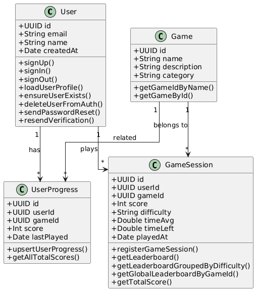

# 🟦 BrainAlpha - Class Diagram

## Overview
This document provides the **Class Diagram** for the MVP version of BrainAlpha.

---

## 🟦 Class Diagram
The following diagram represents the **main classes and relationships** in the system:

---

## 🟦 Class Definitions

### **User (User Management)**
- **Attributes:**
  - `id: UUID`
  - `email: String`
  - `name: String`
  - `createdAt: Date`
- **Methods:**
  - `register()`
  - `login()`
  - `logout()`

---

### **Game (Game Information)**
- **Attributes:**
  - `id: UUID`
  - `name: String`
  - `description: String`
  - `category: String`
- **Methods:**
  - `startGame()`
  - `endGame()`
  - `getGameInfo()`

---

### **UserProgress (Tracking User Progress)**
- **Attributes:**
  - `id: UUID`
  - `userId: UUID`
  - `gameId: UUID`
  - `score: Int`
  - `lastPlayed: Date`
- **Methods:**
  - `saveProgress()`
  - `getProgress()`

---

### **GameSession (Game Play Sessions)**
- **Attributes:**
  - `id: UUID`
  - `userId: UUID`
  - `gameId: UUID`
  - `score: Int`
  - `duration: Int`
  - `playedAt: Date`
- **Methods:**
  - `startSession()`
  - `endSession()`
  - `saveSession()`
  - `pauseSession()`

---

### **Achievement & UserAchievements**
- **Achievement Attributes:**
  - `id: UUID`
  - `name: String`
  - `description: String`
  - `gameId: UUID`
- **Achievement Methods:**
  - `unlock()`
  - `getAchievement()`
- **UserAchievements Attributes:**
  - `id: UUID`
  - `userId: UUID`
  - `achievementId: UUID`
  - `unlockedAt: Date`
- **UserAchievements Methods:**
  - `unlockAchievement()`
  - `getUserAchievements()`

---

### **Leaderboard (Game Ranking)**
- **Attributes:**
  - `id: UUID`
  - `userId: UUID`
  - `gameId: UUID`
  - `score: Int`
  - `rank: Int`
- **Methods:**
  - `updateRank()`
  - `getLeaderboard()`
  - `getUserRank()`

---

### **Settings (User Preferences)**
- **Attributes:**
  - `id: UUID`
  - `userId: UUID`
  - `darkMode: Bool`
  - `language: String`
- **Methods:**
  - `changeSettings()`
  - `getSettings()`

---