# 🧠 BrainAlpha - Mockups

## Overview
This document contains the **mockups** of the BrainAlpha app, showcasing different sections of the interface.

---

## 1️⃣ Authentication Screens

### **Sign Up Screen**
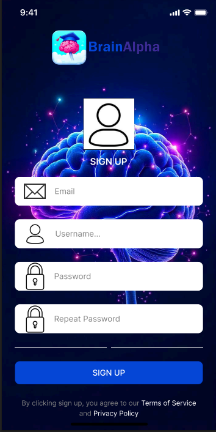
- **Description:** The registration screen allows new users to create an account.
- **Fields:** Email, Username, Password, Repeat Password.
- **CTA:** Sign Up button.

### **Login Screen**
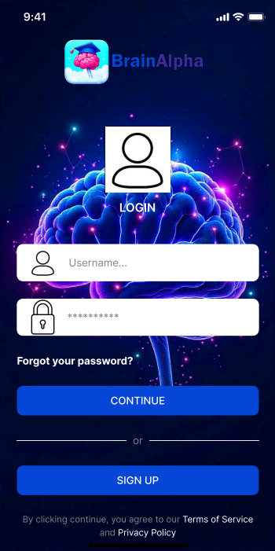
- **Description:** The login screen allows existing users to sign in.
- **Fields:** Username, Password.
- **CTA:** Continue button, Sign Up option.
- **Extras:** Forgot Password link.

---

## 2️⃣ Main Navigation

### **Main Categories Screen**
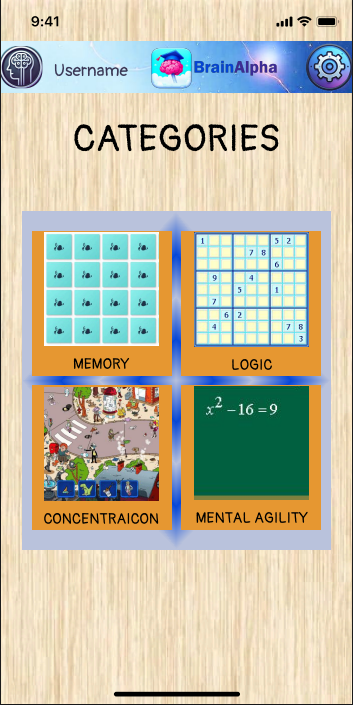
- **Description:** This screen presents the four main game categories:
  - **Memory**
  - **Logic**
  - **Concentration**
  - **Mental Agility**
- **CTA:** Clicking on a category leads to its respective games.

---

## 3️⃣ Game Categories

### **Memory Games**
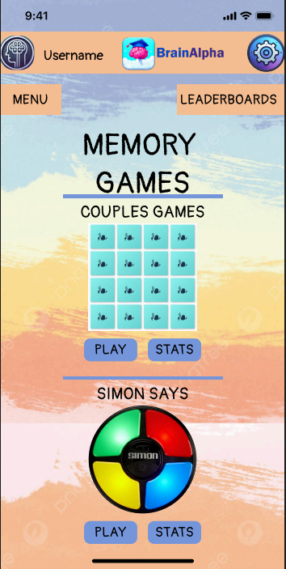
- **Games Included:**
  - **Couples Game** (Matching pairs)
  - **Simon Says** (Color sequence memory test)
- **CTA:** Play button for each game.

### **Logic Games**
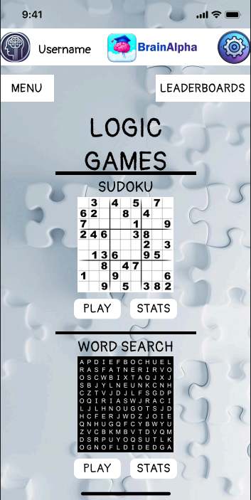
- **Games Included:**
  - **Sudoku**
  - **Word Search**
- **CTA:** Play button for each game.

### **Concentration Games**
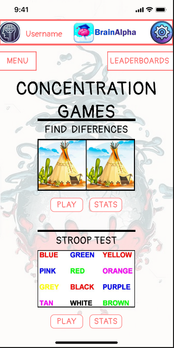
- **Games Included:**
  - **Find the Differences**
  - **Stroop Test**
- **CTA:** Play button for each game.

### **Mental Agility Games**
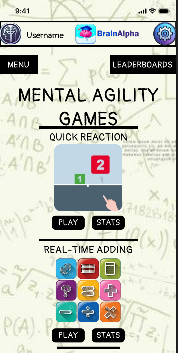
- **Games Included:**
  - **Quick Reaction**
  - **Real-Time Adding**
- **CTA:** Play button for each game.

---

## 4️⃣ Game Screens

### **Couples Game**
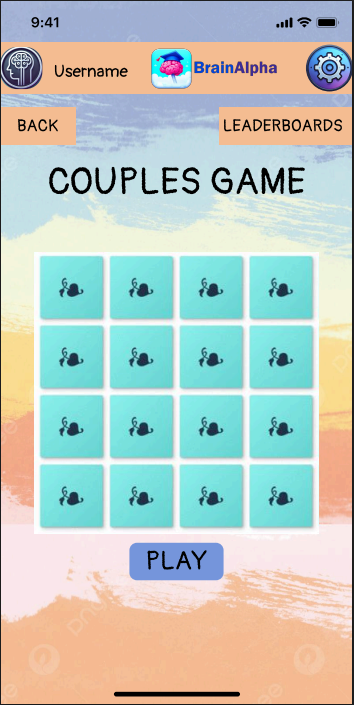
- **Description:** A matching pairs game to improve memory.
- **CTA:** Play button.

### **Sudoku**
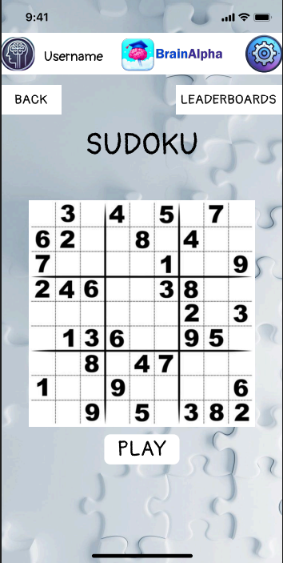
- **Description:** Classic Sudoku puzzle for logic training.
- **CTA:** Play button.

### **Quick Reaction**
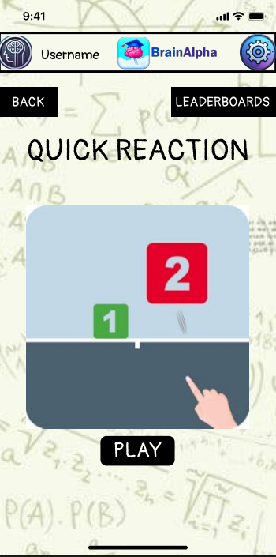
- **Description:** A game to test reaction time and speed.
- **CTA:** Play button.

### **Stroop Test**
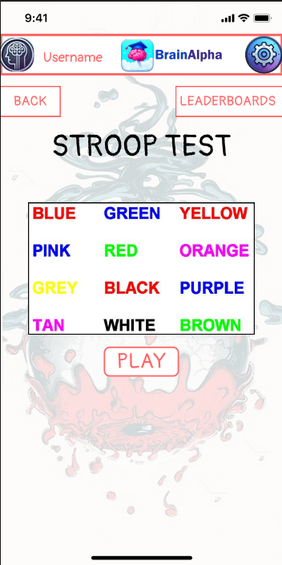
- **Description:** A cognitive game where users must select the correct color, ignoring the word.
- **CTA:** Play button.

---

## 5️⃣ Leaderboards and Progress Tracking
- **Each game screen has access to:**
  - **Leaderboards** (Top players rankings).
  - **Stats** (User progress tracking).

---

## Final Notes
- **These mockups serve as the visual reference for BrainAlpha's UI.**
- **All UI elements follow an intuitive and accessible design for users.**

---

