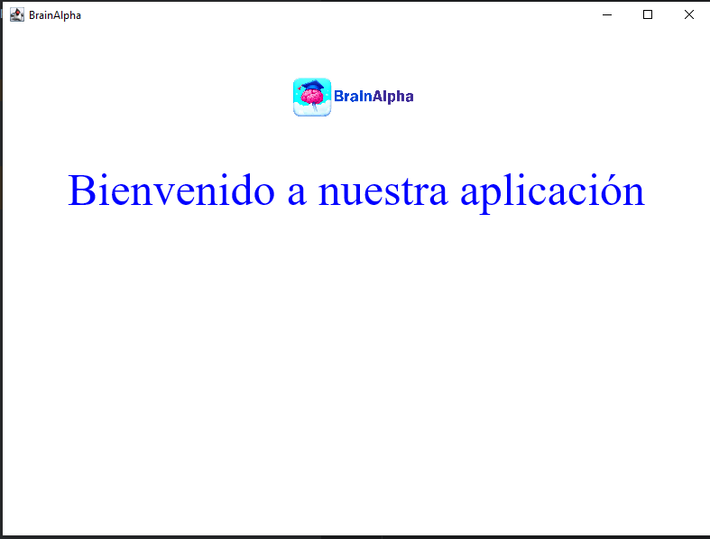
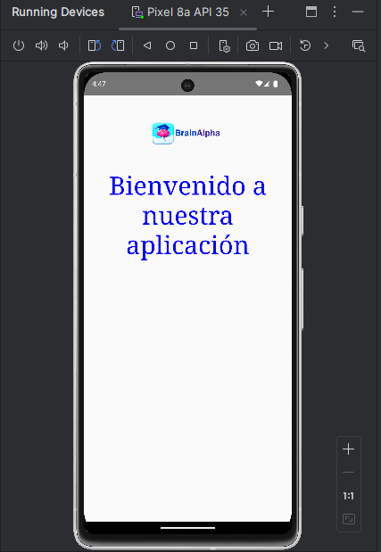

# BrainAlpha - Test Evidences

## Overview
This document contains **testing evidences** for the MVP version of BrainAlpha, demonstrating functionality through screenshots and test results.

---

## 1️⃣ Application Launch

### **Desktop Version**

- **Tested on:** Windows 10  
- **Test Scenario:**  
  - The application launches successfully.
  - The welcome screen is displayed with the **BrainAlpha logo** and text.  
- **Result:** ✅ **Passed**  

### **Android Version**

- **Tested on:** Pixel 8a API 35 (Emulator)  
- **Test Scenario:**  
  - The app starts correctly on an Android device.
  - The welcome screen is fully visible, with correct formatting.  
- **Result:** ✅ **Passed**  

---